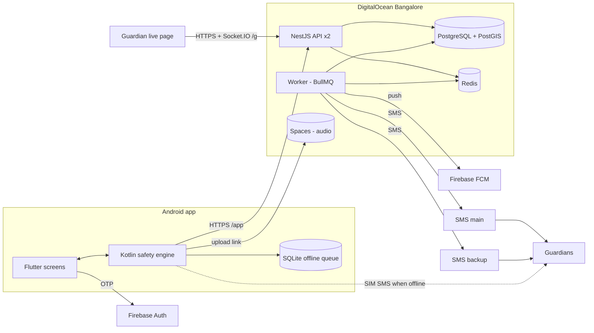

# Sarthi Rakshak — Phase 1 Plan (everything except the admin panel)

> Written on 2026-10-27 · Moment: **validate** — a pilot in Noida that must work every time, with a small number of real users.
> Owner of this plan: Parmeet. The admin panel (build steps 7–8) is owned by Anjali and is **not** in this plan.
> Admin panel status (27 Oct, `main` @ 61ca48c): Settings, Admin Team, Audit Log, Users, SOS & Journey History are done; Alert Log, Dashboard, Live SOS, Support Tickets, Reports and the security check are left.
> **Working mode (decided 27 Oct): local development only.** Everything runs on the developer's laptop; hosting, CI and the Play Store come later (see Track F).
> Status: **draft — waiting for approval.** Nothing here is built yet. Follow `CLAUDE.md`: plan → approve → build → run → test → commit, one step at a time.

## Summary

Phase 1 still needs four parts besides the admin panel: the **server for the app**, **alert sending**,
the **guardian live page** and the **Android app** (Flutter screens + Kotlin safety engine). For now all of it is
built and tested **on the laptop**: the server, worker, database and pages run locally and real phones connect to the
laptop. **Hosting, CI, the Play Store and the pilot launch** are a later stage that starts only when the app works
end to end locally. The stack is already decided and fits the pilot well;
this plan does not change it. It sets the build order, the split with the admin work so we don't collide, the few
database changes still needed, and the risks to test early (mostly Android background limits and Play Store rules).

---

## 1. Alignment score

How well the decided stack fits a safety-critical pilot (Noida, hundreds to a few thousand users, one or two developers).

```
📊 Architecture Alignment — validate moment (safety-critical pilot)

  ✅ NestJS + PostgreSQL/PostGIS   — right size; PostGIS needed for "500 m off route"
  ✅ Redis + BullMQ                — justified now: server-side timers are a core promise, not an optimisation
  ✅ Socket.IO (+ Redis adapter)   — justified: live map for guardians every 3–5 s
  ✅ Flutter + small Kotlin engine — native code is the only reliable way to run in the background on Android
  ✅ Two SMS providers + SIM SMS   — justified: one failed SMS can mean nobody comes
  ✅ DigitalOcean Bangalore        — required by "data stays in India"
  ✅ Local-first (Docker + pnpm)   — right for now: no hosting cost, fast changes; nothing real users depend on yet
  ⚠️  2 API servers + DB standby   — later stage only; correct for an SOS product once real users exist
  ⚠️  Sentry / Crashlytics         — store data outside India; allowed only with personal data scrubbed (see ADR-P1-09)
  ⚠️  SIM SMS (SEND_SMS)           — Google Play restricts this permission; must be checked before we depend on it
  ❌ (nothing premature found)

  Alignment: ~90% — the stack fits; the open items are policy/permission risks, not over-engineering.
```

---

## 2. How this work fits with the admin panel work

Both of us work in the same repo and the same server. To avoid stepping on each other:

### Who owns what

| Area | Owner | Notes |
| --- | --- | --- |
| `apps/admin/`, server `/admin/*` routes, `server/src/admins`, `auth` (admin), `audit`, `settings`, `users` (admin Users screen), `history` | Anjali | Settings values are **read** by my code through `SettingsService`; I reuse `users/phone.ts` (`normaliseIndianMobile`, `maskPhone`) — no edits without asking |
| Server `/app/*` (user app API), `/g/*` (guardian page API), `/webhooks/*` (SMS delivery reports) | Parmeet | All new code under **`server/src/app/`** (`auth`, `profile`, `guardians`, `sos`, `journeys`, `locations`, `checkins`, `support`) plus `server/src/alerts`, `realtime`, `media`, `worker` — so names never clash with the admin `users`/`history` modules |
| `apps/guardian-web/`, `apps/mobile/` | Parmeet | |
| Hosting, CI (GitHub Actions), staging/production | Later stage — not now | Planned in Track F; nothing is set up until local end-to-end works |
| `packages/shared/` (API contract types) | Both | Each adds their own files; small, separate PRs |

### Shared files — always pull first, keep changes small

`server/src/app.module.ts` · `server/src/database/migrator.ts` + `migrations/` · `server/src/database/types.ts` ·
`server/src/config/env.schema.ts` · `.env.example` · `pnpm-workspace.yaml` · root `package.json` · `CLAUDE.md` · `docs/decisions.md`.

- **Migration numbers:** pull `main` before creating a migration and take the next free number (last used: `0009_guardian_relation`, so mine start at `0010`). If two branches
  pick the same number, whoever merges second renumbers. Never edit a migration that is already merged.
- **One branch per step**, named `parmeet/<step>`; open a PR and ask Anjali to review anything that touches shared files.
- **Data the admin screens need from my side** (agree once, then build):
  - Users, History, Alert Log, Dashboard: they read the existing tables (`users`, `devices`, `guardians`, `sos_events`,
    `journeys`, `location_points`, `checkins`, `alerts`, `guardian_links`, `media_clips`). I fill them; I tell Anjali
    before changing any column.
  - Live SOS: my realtime module publishes live points on Redis channel `sos:<id>:location`; the admin side subscribes
    in its own `/admin` Socket.IO namespace (rule: live location to admins only while SOS is active).
  - Dashboard "system health": my `alerts` module exposes a `ProviderHealthService` (push, SMS main, SMS backup).
  - Users screen "Setup complete" = location, notifications, SMS and microphone permissions + battery saving off + one accepted guardian. The app (A2/D3) must report exactly these permission names in `devices.permissions` — agree the key names with Anjali.
  - "Send setup reminder" is disabled until push works; B4 enables it.
  - Guardians have an optional `relation` (e.g. "brother", 1–40 chars, migration 0009) — the guardian API (A3) accepts it.
  - Admin actions that affect the app (block user, send setup reminder, delete user data): admin side calls a service
    I provide (`UsersService.block()`, `NotificationsService.sendSetupReminder()`, existing `deleteUserData`).

---

## 3. Architecture (Phase 1, non-admin parts)

```
 Android phone                                       Guardian's phone (any browser)
 ┌───────────────────────────────┐                   ┌──────────────────────────┐
 │ Flutter screens               │                   │ guardian-web (React)     │
 │   ↕ platform channel          │                   │ live map, battery,       │
 │ Kotlin safety engine          │                   │ "I'm responding", 112    │
 │  foreground service, GPS,     │                   └────────────┬─────────────┘
 │  audio clips, heartbeat,      │   SMS with link (main/backup)  │ HTTPS + Socket.IO /g
 │  check-in detector, widget,   │◄──── SIM SMS if no internet ───┤
 │  tile, SQLite offline queue   │                                │
 └──────────────┬────────────────┘                                │
                │ HTTPS /app/* + Socket.IO (optional)             │
                ▼                                                 ▼
 ┌──────────────── DigitalOcean · Bangalore ──────────────────────────────────┐
 │  API (NestJS, 2 copies)  ── /app  /g  /webhooks  /admin(Anjali)            │
 │        │  writes            │ publishes live points                        │
 │        ▼                    ▼                                              │
 │  PostgreSQL+PostGIS     Redis: latest location, heartbeats (ZSET),        │
 │  (permanent record)            BullMQ queues, pub/sub                     │
 │        ▲                    │                                              │
 │  Worker (same code, `node dist/worker.js`):                               │
 │    send-alert jobs (push/SMS, failover, retries) · timers: no-response,   │
 │    reply-wait, late-arrival · lost-contact sweeper (every 30 s) · cleanup │
 │  Spaces (blr1): encrypted audio clips, uploaded with short-lived links    │
 └────────────────────────────────────────────────────────────────────────────┘
        ├──► Firebase: phone OTP (login), FCM push to the user's phone
        └──► SMS main + backup (DLT templates) ──► guardians
```



The picture above is the **final** shape. For now the same parts run on the laptop:

### 3a. Local development setup (what we use now)

```
 Laptop (Windows)                                           Phones
 ┌──────────────────────────────────────────────────┐      ┌───────────────────────────┐
 │ Docker: PostgreSQL+PostGIS :5433 · Redis :6379   │      │ Android phone (USB cable) │
 │         MinIO :9000 (audio, stands in for Spaces)│      │  adb reverse tcp:3000 →   │
 │ pnpm dev:                                        │◄─────┤  app calls localhost:3000 │
 │   server  :3000  (/app /g /webhooks /admin)      │      └───────────────────────────┘
 │   worker  (alerts, timers)                       │      ┌───────────────────────────┐
 │   admin   :5173  (Anjali)                        │◄─────┤ 2nd phone / laptop browser│
 │   guardian-web :5175                             │ Wi-Fi│ opens guardian link       │
 │ SMS = log provider: prints text + link in console│      └───────────────────────────┘
 └──────────────────────────────────────────────────┘
        └──► Firebase dev project (OTP with test numbers, FCM push) · Google Maps dev key
```

| Need | How it works locally |
| --- | --- |
| Database, Redis | Existing `docker compose up -d` (no change) |
| Server + worker + pages | `pnpm dev` starts server, worker, admin and guardian page together |
| Phone → laptop server | **USB:** `adb reverse tcp:3000 tcp:3000`, so the app uses `http://localhost:3000` (most reliable). **Emulator:** `http://10.0.2.2:3000`. **Wi-Fi:** laptop's LAN IP; server listens on all addresses in development only, plus a Windows firewall rule |
| Plain HTTP from the phone | Debug builds only: Android network-security config allows HTTP to `localhost`, `10.0.2.2` and the laptop IP. Release builds are HTTPS-only |
| Login OTP | A **Firebase dev project** with **test phone numbers** (fixed OTP, no SMS sent, no cost). Automated tests use the **Firebase Auth emulator** |
| Push | FCM from the same dev project (needs internet on laptop and phone) |
| Guardian SMS | **Log provider**: the worker prints the SMS text and the guardian link in the console and records the `alerts` row as normal. Open the link on the laptop or a phone on the same Wi-Fi |
| Guardian link address | `GUARDIAN_WEB_URL` in `.env` (e.g. `http://localhost:5175` or `http://<laptop-ip>:5175`) |
| Audio storage | **MinIO** in Docker (S3-compatible, same upload-link flow as DigitalOcean Spaces), so moving to Spaces later is a settings change, not a code change (needs approval: Q7) |
| Maps | Google Maps dev key, restricted to `localhost` and the debug app's package + signing key |
| Test data | Only what we create by really using the app on our own phones (project rule: no seeded fake data) |

New `.env` settings (added to `.env.example` step by step): `FIREBASE_PROJECT_ID`, `GOOGLE_APPLICATION_CREDENTIALS` (path to the dev service-account file, never committed), `FIREBASE_AUTH_EMULATOR_HOST` (tests), `SMS_PROVIDER=log`, `GUARDIAN_WEB_URL`, `GUARDIAN_WEB_ORIGIN`, `S3_ENDPOINT`, `S3_BUCKET`, `S3_ACCESS_KEY`, `S3_SECRET_KEY`, `GOOGLE_MAPS_KEY`, `USER_TOKEN_SECRET`.

---

## 4. Build order

Rough sizes are for one developer and are estimates only (S ≈ 2–3 days, M ≈ 1 week, L ≈ 2+ weeks).
Server steps and the mobile steps can run side by side; the **Android spike (D1) starts in week 1** because it is the biggest risk.
Everything in Tracks A–E is built and tested **locally**. Track F (hosting, CI, Play Store) waits until local end-to-end works.

### Track A — Server for the app

| # | Step | Size | Done when |
| --- | --- | --- | --- |
| A00 | **Local setup for the app side**: `pnpm dev` also starts the worker and guardian page; MinIO in `docker-compose.yml` (after Q7); Firebase dev project + test numbers; `.env.example` entries; short "run the app locally" section in `SETUP.md` | S | A phone on USB reaches `/health` on the laptop |
| A0 | **API contract** in `packages/shared` (request/response types for `/app` and `/g`), agreed with Anjali; add `packages/shared` to the workspace | S | Types compile in server and both web apps |
| A1 | **Phone login**: app signs in with Firebase phone OTP → `POST /app/auth/firebase` verifies the ID token (`firebase-admin`) → server creates `users` row (first time) + its own session token (stored hashed, like admin sessions). Refresh, logout, consent recorded (`consent_at`). Blocked users: refuse login, new journeys and new guardian invites, but **SOS always works** (already decided in `decisions.md`) | M | Login works from a test script against the Firebase emulator; tests for new/returning/blocked user |
| A2 | **Profile + device**: name, photo (upload link to MinIO locally, Spaces later), blood group; register device (model, Android, app version, FCM token, permissions, battery-saver state) used by the admin "setup status" | S | Admin Users screen data appears from a real phone |
| A3 | **Guardians + invites**: add up to `guardian.max_count`; SMS invite with accept/decline link; decline removes the phone and adds its hashed number to a "do not invite again" list; invite rate limits | M | Tests for limit, decline, re-invite blocked |
| A4 | **SOS core**: `POST /app/sos` with the phone-made id (idempotent), trigger type, test flag; saves a **snapshot of the rules** in force; creates one secret guardian link per guardian (hashed); `POST /app/sos/:id/end` ("I'm safe") / cancel during countdown; link expiry = end + `guardian.link_live_after_end_minutes` | M | Same SOS sent 3 times → one record; tests for test SOS, cancel, end |
| A5 | **Location intake**: batched points (`POST /app/locations`), latest point in Redis, saved to `location_points`, published for the live page; heartbeat `POST /app/heartbeat` | M | 1 point / 3 s from 50 fake clients in a **test-only** load script stays fast |
| A6 | **Journeys + check-ins**: start (destination, arrival time, optional route), "I reached safely", end; check-in created by the phone (off route / stopped) or by the server (late); answers: I'm fine / Stuck in traffic / SOS | M | Tests for each answer and for the pause |
| A7 | **History + account**: past journeys and SOS for the user; "delete my account" (uses existing `deleteUserData`); support ticket "report a problem" | S | Delete leaves SOS/alerts anonymous (existing rule) |

### Track B — Alert sending and server timers (worker)

| # | Step | Size | Done when |
| --- | --- | --- | --- |
| B1 | **Worker process + queues**: `server/src/worker.ts` with BullMQ; same codebase, own start command; jobs are idempotent (job id = alert/timer id) | S | Worker starts, health visible |
| B2 | **SMS adapter**: one interface, two providers (main/backup, chosen in Phase 0, e.g. MSG91 / Gupshup), DLT template ids in settings/env; a **log-only provider for development** (never allowed when `NODE_ENV=production`) | M | Unit tests for each provider with recorded responses |
| B3 | **Send + failover + retries**: one `alerts` row per attempt; main fails/timeouts → backup; retry with backoff; delivery reports via `/webhooks/sms/:provider` (signed) | M | Tests: main down → backup sends; delivered/failed recorded |
| B4 | **Push (FCM)** to the user's phone (check-in prompts, "guardian is responding", "SOS ended"); to guardians only if they also have the app (Q4) | S | Push arrives on a real phone |
| B5 | **Timers** (each reads the snapshot rules of its SOS/journey): no guardian responds in N min → re-send + tell the app to offer 112; check-in reply wait → `checkin_no_reply` alert (not full SOS); late arrival; **lost contact** sweeper every 30 s over a Redis sorted set of last heartbeats | M | Tests with a fake clock; timers still fire if the phone is gone |
| B6 | **Cleanup jobs**: expire guardian links, delete audio after `delete_after` (unless kept), delete old location points once retention is agreed (Q2) | S | Tests |

### Track C — Guardian live page (`apps/guardian-web`)

| # | Step | Size | Done when |
| --- | --- | --- | --- |
| C1 | Vite + React + TypeScript, **no Ant Design**, small bundle (target < 150 KB gzip before the map) so it opens fast on a cheap phone over 3G | S | Opens on a real low-end phone |
| C2 | `/g/:code` page: name, blood group, battery, last update ("2 min ago"), Google Map with trail; Socket.IO `/g` namespace; falls back to polling every 5 s | M | Live dot moves during a test SOS |
| C3 | Buttons: "I'm responding" (others see who is coming), Call user, Call 112; expired link page; `noindex`, rate limits, no token in logs | S | Playwright tests for live, ended, expired, wrong code |

### Track D — Android app (`apps/mobile`)

| # | Step | Size | Done when |
| --- | --- | --- | --- |
| D1 | **Spike (first!)**: tiny Kotlin app that starts SOS from a **widget** and a **quick-settings tile** with the screen off, runs a location + microphone foreground service, survives being swiped away, on Android 12–15 and 3 brands (Xiaomi, Samsung, Vivo) | M | Written result: what works, what needs the app to come to the front |
| D2 | Flutter project + Kotlin engine skeleton + platform channel; Firebase dev project (OTP, FCM; Crashlytics later); API address from build settings (debug → laptop); API client from `packages/shared` contract | M | Login on a real phone against the laptop server |
| D3 | Setup screens: login, consent, profile, guardians from contacts (up to 5), **safety setup check** (permissions + per-brand "stop killing the app" guides), test SOS | L | New user can be fully set up |
| D4 | **SOS flow**: big button, widget, tile → 5-s countdown (no PIN) → engine saves SOS locally first, starts location (3–5 s, slower on low battery), audio clips, sends to server; no internet → SIM SMS (or SMS composer, see R2); call 112 (dialer); "I'm safe" | L | Works with screen off, no internet, battery saver |
| D5 | **Offline queue**: SQLite queue for SOS, points, check-in answers; WorkManager retries; ids made on the phone | M | Airplane mode → back online → no duplicates |
| D6 | **Audio**: 30-s clips, encrypted with an Android Keystore key, uploaded with short-lived upload links (MinIO locally, Spaces later), keep/delete by user; only the user can play | M | Admin can see "3 clips" but never play them |
| D7 | **Journey mode + smart check-ins**: destination (Google Places), arrival time, route; detector for off route (500 m) and stopped (3 min) in Kotlin; check-in screen with 3 buttons; heartbeat 30–60 s | L | A real drive triggers the right check-ins (phone on mobile data needs the server reachable: use the Wi-Fi/LAN setup on a hotspot, or wait for staging) |
| D8 | History, report a problem, delete account; the text "Sarthi Rakshak alerts your guardians and helps you call 112. It is not a 24/7 monitoring service." | M | |

### Track E — Testing on real phones (local)

| # | Step | Size | Done when |
| --- | --- | --- | --- |
| E1 | **Local test sheet**: for each phone, SOS and journey with screen off, app swiped away, battery saver, airplane mode then back online, restart, low battery — phones connected to the laptop server | M | Written results per phone |
| E2 | **Phone matrix**: repeat E1 on the 8–10 brands (Xiaomi, Samsung, Vivo, Oppo, Realme, OnePlus, Motorola) as phones become available | L | All pass or have a documented workaround |

Note: tests that need the phone **away from the laptop** (long drives on mobile data, lost-contact in the real world) can only be done fully once staging exists (Track F). Until then: laptop + phone on the same hotspot, or short walks within Wi-Fi range.

### Track F — Later stage: hosting, CI, launch (not now)

**Starts when:** Tracks A–E work end to end locally (SOS → SMS log → guardian page → "I'm safe"; journey → check-in → timers) **and** the client has the DigitalOcean, Play Console and DLT pieces from Phase 0.

| # | Step | Size | Done when |
| --- | --- | --- | --- |
| F1 | **CI** (GitHub Actions): lint, server tests with PostGIS + Redis services, admin + guardian Playwright, Flutter tests | S | Every PR is checked |
| F2 | **Staging** on DO Bangalore: 1 API + worker, managed PostgreSQL (PostGIS), managed Redis-compatible store, Spaces blr1 (replaces MinIO), HTTPS, limited DB user (existing decision), migrations as owner; real SMS providers with DLT | M | Phones in testing use staging |
| F3 | **Production**: 2 API copies behind a load balancer, worker, DB with standby + daily backups + point-in-time restore, uptime checks every minute, error reports with personal data scrubbed | M | Restore drill done once |
| F4 | **Field testing on staging**: real drives in Noida on mobile data, lost contact, no-response timer | M | Test sheet passes away from the laptop |
| F5 | **Play Store**: privacy policy, data safety form, foreground-service and location declarations, SMS permission declaration (if used), internal → closed testing → production | M | Approved and live for Noida pilot users |

### Suggested sequence (one developer)

```
Week  1-2   A00 local setup · A0 contract · D1 Android spike · A1 login
Week  3-4   A2 profile · A3 guardians · B1-B2 worker + SMS log provider · D2 app skeleton
Week  5-7   A4 SOS · A5 locations · B3 failover · C1-C3 guardian page · D3 setup screens
Week  8-10  B4-B5 push + timers · D4-D5 SOS flow + offline · E1 local test sheet
Week 11-13  A6 journeys · D6 audio (MinIO) · D7 journey mode · B6 cleanup
Week 14-15  A7 + D8 extras · E2 phone matrix
── local end-to-end done ──
Later       Track F: CI, staging, field tests, production, Play Store (needs DLT, DO, Play Console)
```

Show the client a demo **from the laptop** (screen share or in person) after A4+C2 (first end-to-end SOS) and after D7.

---

## 5. Database changes still needed

The 14 tables exist. These additions are needed for the app side (one migration per step, numbered as above):

| Change | For step | Why |
| --- | --- | --- |
| New `user_sessions` (token hash, user, device, expires, revoked) | A1 | App login sessions, same pattern as `admin_sessions` |
| New `guardian_invite_blocklist` (HMAC of phone, user, created) | A3 | Existing decision: hashed "do not invite again" list |
| `guardians.invite_token_hash` | A3 | Accept/decline link |
| `sos_events.rules` and `journeys.rules` (jsonb snapshot) | A4, A6 | Existing decision: a running SOS/journey keeps the old rules |
| `journeys.route` (geography LineString) | A6 | Off-route check |
| `checkins.paused_until`, `checkins.source` (phone/server) | A6 | "Stuck in traffic" pause; who raised it |
| `alerts.provider_message_id` (no personal data) | B3 | Match delivery reports from the SMS provider |
| `alerts.type` add `invite`, `checkin` | A3, B4 | Invite SMS and check-in push are tracked like other alerts |

---

## 6. Use now

### NestJS server (existing) + new user-side modules
- **Role:** `/app`, `/g`, `/webhooks` APIs, same process as `/admin`.
- **Why now:** one codebase, one deploy, one set of tests for a 1–2 person team.
- **When to replace:** never split into services in Phase 1; reconsider only if the API needs > 4 copies to keep p95 under 300 ms.

### Worker process (same code, separate start)
- **Role:** alert sending, failover, retries, timers, cleanup.
- **Why now:** "server watches the clock" is a core promise; sending SMS inside a web request would lose alerts on a restart.
- **When to replace:** add more worker copies when queue wait for `send-alert` exceeds 5 s.

### Redis + BullMQ
- **Role:** delayed timer jobs, alert queue, latest location, heartbeats, Socket.IO adapter.
- **Why now:** needed for timers and live map from the first SOS.
- **When to replace:** not in Phase 1.

### Firebase Auth (phone OTP) + FCM
- **Role:** login OTP before DLT is ready; push to the user's phone.
- **Why now:** works without DLT; standard on Android; holds only the phone number.
- **When to replace:** move OTP to our own DLT SMS if Firebase OTP cost passes the SMS provider cost by 2× (see cost traps).

### SMS main + backup behind one adapter
- **Role:** guardian alerts and invites.
- **Why now:** guardians have no app — SMS is the only channel that always reaches them.

### Kotlin safety engine (foreground service) + Flutter screens
- **Role:** everything that must keep running with the screen off / app swiped away.
- **Why now:** Flutter alone cannot run reliably in the background on Xiaomi/Vivo/Oppo.

### Local development stack (Docker + pnpm + MinIO)
- **Role:** run everything on the laptop while the app is built.
- **Why now:** no users yet, no hosting cost, fastest feedback; matches the team's choice to build locally first.
- **When to replace:** move to staging when local end-to-end works and DLT + DigitalOcean are ready (Track F).

### Guardian page: Vite + React, no UI library
- **Why now:** must open in seconds from an SMS on a cheap phone.

---

## 7. Add later

- **Socket.IO from the phone** — add when polling/HTTP batches cannot keep the live map under 10 s delay; start with HTTPS batches from the phone (simpler, works with the offline queue).
- **Read replica for PostgreSQL** — add when admin reports slow the main DB (p95 query > 200 ms) or active users > 20k.
- **More API copies / autoscaling** — add when CPU stays above 60% for 15 min at peak.
- **"All the time" location, shake/voice SOS, photo at SOS** — Phase 2 (see `later-phases.md`).
- **iPhone app** — Phase 4, after the Android app is stable.

## 8. Don't use now

- **Hosting, CI, DigitalOcean resources** — team decision: local development first. Start Track F only when local end-to-end works.
- **Tunnels that put the laptop on the internet (ngrok, Cloudflare Tunnel, etc.)** — route traffic outside India and expose a dev machine; use USB / same Wi-Fi instead. Reconsider only if a provider's delivery-report webhook must be tested before staging exists.

- **Kubernetes / microservices** — 1–2 developers, a few thousand users; DigitalOcean droplets or App Platform are enough. Reconsider when there are > 5 developers or > 6 services.
- **Kafka or another message broker** — BullMQ on Redis already covers queues and timers at pilot scale. Reconsider at > 1,000 alerts per minute sustained.
- **A separate realtime service (Pusher, Ably, Firebase Realtime DB)** — stores location outside India and adds a vendor. Keep Socket.IO on our own servers.
- **GraphQL** — the app and guardian page have a small, fixed set of calls; typed REST in `packages/shared` is simpler.
- **WhatsApp alerts, auto-call to guardians, silent alert, fake call, Hindi** — excluded by scope (WhatsApp only through a Change Request).
- **Admin-side "simulator" or seeded fake users/SOS** — project rule: no fake data in dev/staging. Load scripts run only against the test database.

---

## 9. Decision records (proposed — add to `docs/decisions.md` once approved)

### ADR-P1-01: App login = Firebase OTP, then our own session
- **Choice:** Firebase phone OTP on the phone; server verifies the Firebase ID token once and issues its own long-lived session token (hashed in `user_sessions`, refresh on use, revocable).
- **Why:** OTP works before DLT is ready; our session lets us block users, log out devices and avoid calling Firebase on every request.
- **Tradeoff:** two systems to understand; Firebase OTP has a per-SMS cost.
- **Revisit when:** DLT is live and Firebase OTP costs more than our SMS provider.

### ADR-P1-02: The SOS id is made on the phone; every write is idempotent
- **Choice:** UUID from the phone for SOS, location batches and check-in answers; server ignores repeats.
- **Why:** offline-first; retries must never create a second SOS.
- **Revisit when:** never in Phase 1.

### ADR-P1-03: Rules snapshot on each SOS and journey
- **Choice:** at start, copy the current settings into `rules` on the record; timers read only the snapshot.
- **Why:** implements the agreed rule "a settings change never changes a running emergency".
- **Tradeoff:** a small jsonb per record.

### ADR-P1-04: Timers = BullMQ delayed jobs; lost contact = sweeper
- **Choice:** delayed jobs for no-response, reply-wait and late arrival (re-check the database when they fire); a repeating job every 30 s finds heartbeats older than the limit in a Redis sorted set.
- **Why:** survives restarts and a dead phone; the sweeper avoids re-creating a job on every heartbeat.
- **Tradeoff:** lost-contact alert can be up to 30 s later than the exact limit.
- **Revisit when:** active journeys > 50k.

### ADR-P1-05: Phone sends locations over HTTPS in small batches
- **Choice:** the engine posts batches (1–5 points) instead of keeping a socket open; server pushes to the guardian page with Socket.IO.
- **Why:** fits the offline queue and WorkManager; fewer things to keep alive on Android.
- **Revisit when:** live delay on the guardian page goes above 10 s in testing.

### ADR-P1-06: One SMS adapter, two providers, a dev log provider
- **Choice:** a single `SmsProvider` interface; main → backup on error or timeout (10 s); a log-only provider in development that the server refuses to use in production.
- **Why:** failover is a core promise; developers can test before DLT is approved without sending real SMS.

### ADR-P1-07: Guardian link = long random code in the path, hashed in the DB
- **Choice:** 128-bit random code, SHA-256 stored, expires with the SOS; rate-limited, `noindex`, never logged.
- **Why:** existing privacy rule; anyone with the SMS can open it, nobody can guess it.

### ADR-P1-08: Call 112 opens the dialer
- **Choice:** `ACTION_DIAL` with 112 filled in (no `CALL_PHONE` permission).
- **Why:** one tap more, but no extra permission for Play review; Android routes emergency numbers to the dialer anyway.

### ADR-P1-10: Local-first development
- **Choice:** build and test everything on the laptop (Docker services, `pnpm dev`, phones over USB/Wi-Fi, Firebase test numbers, SMS log provider, MinIO for audio); no hosting or CI yet.
- **Why:** team decision; no cost and quick changes while nothing real depends on the system.
- **Tradeoff:** no field tests away from the laptop; no automatic checks on PRs (run `pnpm test` and `pnpm lint` before every push instead).
- **Revisit when:** local end-to-end works, or a second developer starts pushing mobile code daily.

### ADR-P1-11: MinIO stands in for DigitalOcean Spaces locally
- **Choice:** S3-compatible MinIO container; the server uses the S3 API with a configurable endpoint.
- **Why:** same short-lived upload-link flow as production, so audio and photo uploads are tested for real; switching to Spaces is only `.env`.
- **Tradeoff:** one more Docker container in a shared file (needs Anjali's OK).

### ADR-P1-09: Error reports without personal data
- **Choice:** Sentry (server) and Crashlytics (app) only with phone numbers, names, locations and tokens scrubbed before sending; or self-hosted error tracking on DO if the client prefers.
- **Why:** both services store data outside India (rule 1).
- **Revisit when:** the client's lawyer reviews the privacy policy.

---

## 10. Risks to check early

| # | Risk | What we do |
| --- | --- | --- |
| R1 | Android 14/15 limits starting a **location + microphone foreground service** from a widget or tile while the app is in the background | Spike D1 in week 1. If blocked, the widget/tile opens the SOS screen first (one extra moment) — tell the client |
| R2 | Google Play restricts **SEND_SMS** (SIM SMS) to approved uses | Check the current Play SMS policy and apply for a declaration; fallback: open the SMS app with message + numbers filled in (user taps Send) |
| R3 | Phone makers kill background apps (Xiaomi, Vivo, Oppo, Realme) | Safety setup check with per-brand guides; real-phone matrix E2 |
| R4 | **DLT not ready** → no guardian SMS in production | Ask the client now (Phase 0); build and test with the log provider meanwhile |
| R7 | **Local-only blind spots**: real drives, mobile-data gaps and lost contact away from Wi-Fi can't be fully tested locally | Test what we can on a hotspot; keep F4 field tests on staging before any pilot user |
| R8 | **No CI yet**: a broken test can reach `main` | Run `pnpm lint` and `pnpm test` before every push; review each other's PRs |
| R5 | SMS delivery reports late or missing | Treat "sent, no report in 10 min" as unknown, not delivered; show it in the Alert Log |
| R6 | Google Maps / Firebase data leaving India | Only map tiles and the login phone number go to Google; no location history is stored there; noted in privacy policy |

## 11. Open questions for the project owner

1. **Q1** Which SMS providers (main/backup)? Needed before B2 is finished.
2. **Q2** How long do we keep location points after a journey/SOS? (`location_points.delete_after` is waiting for this.)
3. ~~**Q3** Can a blocked user raise an SOS?~~ **Answered** in `decisions.md`: blocking stops login, new journeys and new invites; never an SOS or a running journey.
4. **Q4** Guardians who also have the app: push as well as SMS, or SMS only in Phase 1?
5. **Q5** Short-link domain for guardian links and DLT templates (exact SMS text, about 10 templates).
6. **Q6** (later, Track F) DigitalOcean App Platform or plain droplets? (Suggestion: App Platform — less server upkeep.)
7. **Q7** OK to add **MinIO** to `docker-compose.yml` for local audio/photo uploads? (Shared file — needs Anjali's agreement too.)

---

## 12. Cost estimate (rough, check with real quotes)

- **Monthly now (local development):** about **$0** — Docker on the laptop; Firebase test numbers and FCM are free; Google Maps dev usage stays inside the free monthly credit.
- **Monthly when staging starts (Track F):** about **$60–90** — 1 small API/worker, managed PostgreSQL (single node), managed Redis-compatible store, Spaces ($5).
- **Monthly at pilot launch (staging + production):** about **$200–300** — 2 API copies + load balancer, worker, PostgreSQL with standby, Redis, Spaces, uptime checks; plus SMS credits (bought by the client) and Google Maps usage.

### Cost traps
- **Firebase phone OTP** is charged per SMS after the free allowance; OTP abuse can burn money — add per-number and per-device limits (already a privacy rule).
- **SMS re-sends**: the no-response timer re-sends to every guardian; cap re-sends per SOS (e.g. 2).
- **Google Maps on the guardian page**: each page open loads a map; use one map load per visit and no Directions calls from the page.
- **Location rows**: 1 point / 3 s during SOS adds up fast; set retention (Q2) before launch.
- **DB standby** doubles the database cost — required for production, not for staging.

---

## 13. Agent rules (for Claude Code working on this plan)

- DO NOT change the tech stack in `CLAUDE.md` without asking.
- DO NOT set up hosting, CI, DigitalOcean resources or internet tunnels now — local development only until Track F is approved.
- DO keep everything runnable with `docker compose up -d` + `pnpm dev`; every address (API, guardian page, storage) comes from `.env`.
- DO allow plain HTTP only in debug builds and only to localhost / emulator / laptop IP; release builds stay HTTPS-only.
- DO run `pnpm lint` and `pnpm test` before every push (there is no CI yet).
- DO NOT edit admin-owned code (`apps/admin`, `server/src/admins`, `server/src/auth`, `server/src/audit`, `server/src/settings`, `server/src/users`, `server/src/history`) — ask Anjali or the owner first.
- DO put user-app server code under `server/src/app/`.
- DO pull the latest main before creating a migration; take the next free number; never edit a merged migration.
- DO make every SOS, location and check-in write idempotent using the id made on the phone.
- DO read safety rules from the snapshot stored on the SOS/journey, never live from `settings`, inside timers.
- DO NOT put phone numbers, names or provider error text with personal data into `alerts`, `audit_log` or logs.
- DO NOT send real SMS from development; use the log provider. The server must refuse the log provider in production.
- DO NOT add Kafka, GraphQL, Kubernetes, microservices or a third-party realtime service.
- DO NOT seed fake users, SOS events or alerts into dev or staging; load and timer tests run only on `sarthi_test`.
- DO NOT build excluded features: auto-call to guardians, silent alert, fake call, Hindi, WhatsApp.
- DO keep the guardian page free of Ant Design and heavy libraries.
- DO show "It is not a 24/7 monitoring service." wherever the app explains SOS.

## Changelog

| Date | Reason | Changes |
|------|--------|---------|
| 2026-10-27 | Initial plan for Phase 1 non-admin work | — |
| 2026-10-27 | Pulled `main` (61ca48c) | Admin progress; app code moves to `server/src/app/`; migrations start at 0010; Q3 answered; Users-screen setup fields and guardian `relation` added to the hand-off list |
| 2026-10-27 | Team decision: build locally first | Added local setup (3a), step A00, MinIO, Firebase test numbers, SMS log provider; testing is local (Track E); hosting, CI, field tests and Play Store moved to a later Track F; costs, risks, Q7, ADR-P1-10/11, agent rules updated |
| 2026-10-27 | Owner removed fake call | D8 no longer includes fake call; added to the excluded list |
